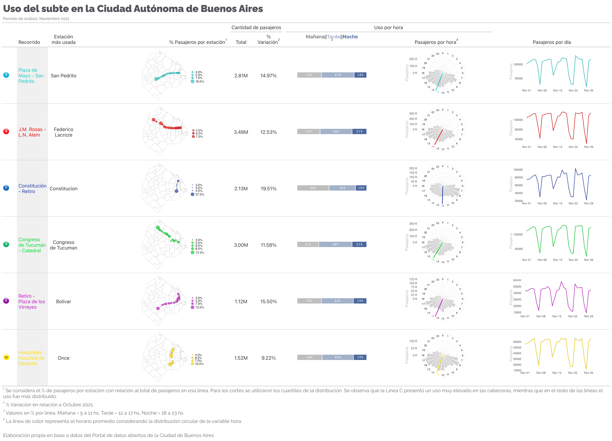
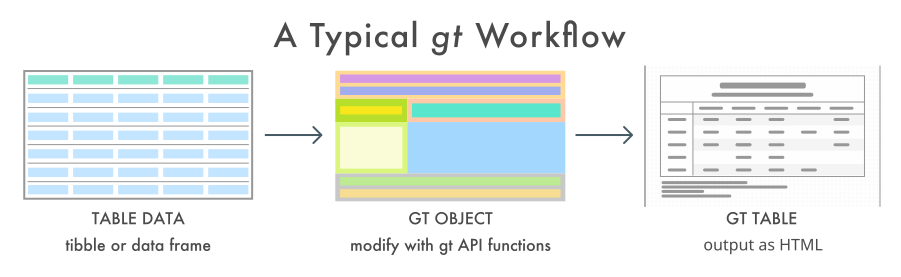
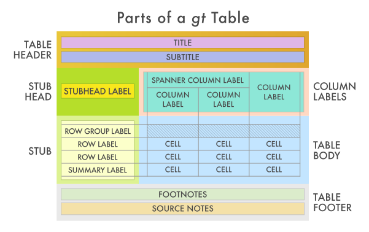
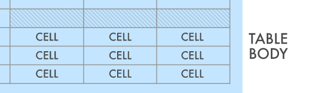

\renewcommand{\figurename}{Figura}

```{r}
#| label: "setup"
#| include: false
knitr::opts_chunk$set(
  echo = TRUE, 
  eval = TRUE,
  warning = FALSE, 
  message = FALSE, 
  code_folding=TRUE,
  code_summary="Mostrar código",
  align='center'
)
options(scipen=999)
```

# Introducción

El paquete **{ggplot2}** 📦[^1] es uno de los paquetes más utilizados para la visualización de datos en R. Está basado en **the Grammar of Graphics**, @wilkinson2012grammar, y permite generar gráficos mediante capas. Por otro lado, **the Grammar of Tables {gt}** 📦 [^2] se utiliza para generar tablas con una estructura similar a la de {ggplot2}, utilizando capas. Ambos enfoques pueden combinarse generando tablas que incluyen gráficos. En este caso, armé un ejemplo con datos provistos por el portal de datos abiertos de la Ciudad Autónoma de Buenos Aires. La idea de este post surgió de una [publicación de Benjamin Nowak en Twitter](https://twitter.com/BjnNowak/status/1472562727684124688).

En este post se muestran los pasos para generar la siguiente tabla: 

```{r}
#| label: "include-table-image"

```


[^1]: @gggplot2

[^2]: @gt

The grammar of tables se basa en la siguiente estructura:

```{r}
#| label: "gt-workflow"
#| fig.cap: 'Workflow con tablas gt, fuente: https://gt.rstudio.com'


```

En donde las tablas tienen un formato específico, generado mediante capas:


```{r}
#| label: "gt-table-structure"
#| fig.cap: 'Estructura de tablas gt, fuente: https://gt.rstudio.com'


```

# 1️⃣ Librerías

Se cargan las librerías a utilizar. Principalmente se utilizarán **{ggplot2}**, incluida en el ecosistema **Tidyverse**[^3], y **{gt}**.

[^3]: @tidyverse

```{r}
#| label: "load-packages"
library(tidyverse) # Manipulación de datos
library(lubridate)  # Manipulación de fechas
library(circular) # Datos periódicos
library(gt) # Tablas
library(gtExtras) # Extras de tablas gt
library(gtsummary) # Tablas resúmen
library(reshape) # Untable
library(sf) # Trabajar con mapas
library(stringr)
conflicted::conflict_prefer("filter", "dplyr")
conflicted::conflict_prefer("select", "dplyr")

options(scipen=999)
```

# 2️⃣ Datos

Se importan los datos de [viajes en subte de la Ciudad Autónoma de Buenos Aires](https://data.buenosaires.gob.ar/dataset/subte-viajes-molinetes), en Noviembre 2021.

```{r}
#| label: "load-november-data"
base_url = 'https://cdn.buenosaires.gob.ar/datosabiertos/datasets/sbase/subte-viajes-molinetes/'
mes_url  = 'molinetes_112021.csv'


df <- read_delim(
    paste0(base_url, mes_url),
    delim = ';',
    col_types = cols(FECHA = col_date("%d/%m/%Y"))
  ) %>%
  
  # Limpieza de los nombres de las columnas
  janitor::clean_names() %>%
  
  # Existen algunos datos sin fecha
  filter(!is.na(fecha)) %>%
  
  # Hora en formato correcto
  mutate(hora = hour(desde)) %>% 
  
  # Se asigna el color correspondiente a cada línea
  mutate(
    linea=str_replace(linea, 'Linea',''),
    color = case_when(
      linea == 'A' ~ '#18cccc',
      linea == 'B' ~ '#eb0909',
      linea == 'C' ~ '#233aa8',
      linea == 'D' ~ '#02db2e',
      linea == 'E' ~ '#c618cc',
      linea == 'H' ~ '#ffdd00',
      TRUE ~ 'black'
    )
  ) %>% 
  
  # Selección de variables relevantes
  select(linea, color, fecha, desde, hasta, hora, linea, molinete, estacion, 
         pax_pagos, pax_pases_pagos, pax_franq, pax_total)
```

Se obtienen los datos del mes anterior para generar comparaciones:

```{r}
#| label: "load-october-data"
mes_url = 'molinetes_102021.csv'

df_oct <- read_delim(
    paste0(base_url, mes_url),
    delim = ';',
    col_types = cols(FECHA = col_date("%d/%m/%Y"))
  ) %>% 
  # Limpieza de los nombres de las columnas
  janitor::clean_names() %>%
  
  # Existen algunos datos sin fecha
  filter(!is.na(fecha)) %>%
  
  # Hora en formato correcto
  mutate(hora = hour(desde)) %>% 
  
  # Se asigna el color correspondiente a cada línea
  mutate(linea=str_replace(linea, 'Linea',''))

```

# 3️⃣ Análisis exploratorio de los datos

```{r}
#| label: "gt-preview-data"
#| column: page
df %>% select(-color) %>% 
  head(5) %>% 
  gt() %>% 
  tab_header(title=md('**Formato de los datos (primeras 5 filas)**'),
             subtitle='Cantidad de pasajeros por molinete 
             y por estación de todas las estaciones de la 
             red de subte, Noviembre 2021') %>% 
  opt_align_table_header('left') %>% 
  tab_footnote(locations=cells_column_labels(columns=molinete),
               'Se ignorará el molinete específico y se considerarán 
               los datos agregados a nivel estación')
```

Se observa la distribución de pasajeros por hora. La cantidad total de pasajeros difiere entre líneas.

```{r}
#| label: "plot-passengers-by-hour"
#| fig.cap: 'Pasajeros por hora, Noviembre 2021'
df %>%
  group_by(linea, color, hora) %>%
  summarise(pax_total=sum(pax_total)) %>%
  ungroup() %>%
  ggplot(aes(x=hora, y=pax_total, fill=color))+
  geom_col(color='white')+
  scale_fill_identity()+
  facet_wrap(~linea)+
  scale_y_continuous(labels = scales::label_number(suffix = "k", 
                                           scale = 1e-3, 
                                           big.mark = ","))+
  theme_bw()+
  labs(x='Hora', y='Pasajeros totales', 
       title='Cantidad de pasarjeros por hora por línea',
       subtitle='Noviembre 2021',
       caption='Fuente: Elaboración propia en base a datos del portal de datos abiertos de la Ciudad de Buenos Aires')
```

# 4️⃣ Transformaciones y gráficos

Se realizan algunas transformaciones y se generan las funciones que luego se utilizarán para generar gráficos a incorporar a una tabla.

## 4.1 Hora de uso de cada línea de subte

Función para obtener la hora promedio:

```{r}
#| label: "get-hour"
get_hour <- function(.linea, .df) {
  temp <- .df %>%
    filter(linea == .linea) %>%
    select(hora, pax_total)
  
    hora <- untable(temp, num = temp$pax_total) %>%
      select(-pax_total) %>%
      mutate(hora_circular = circular(hora, 
                                      template = "clock24", 
                                      units = "hours")) %>%
      summarise(hora = mean(hora_circular)) %>%
      pull(hora)
  
  as.numeric(hora) %% 24
}
```

Función para generar un gráfico circular de la cantidad de pasajeros por hora por línea de subte:

```{r}
#| label: "plot-clock"
plot_clock <- function(.linea, .df, .color = 'black', .hora_promedio) {
  temp <- data.frame(hora = seq(0, 23)) %>%
    left_join(
      .df %>%
        filter(linea == .linea) %>%
        group_by(hora) %>%
        summarise(pax_total = sum(pax_total)) %>%
        ungroup()
    ) %>%
    mutate(color_hora = ifelse(hora == round(.hora_promedio), TRUE, FALSE)) %>%
    mutate(pax_total = ifelse(is.na(pax_total), 0, pax_total))
  
  temp %>%
    ggplot(aes(x = hora, y = pax_total)) +
    geom_col(color = 'white', fill = 'lightgrey') +
    coord_polar(start = 0) +
    geom_vline(xintercept = .hora_promedio,
               color = .color,
               size = 2) +
    geom_label(
      aes(
        x = hora,
        y = max(pax_total) + quantile(pax_total, 0.3),
        color = color_hora,
        label = hora
      ),
      size = 6,
      label.size = NA,
      show.legend = FALSE
    ) +
    scale_color_manual(values = c('black', .color)) +
    scale_x_continuous(
      "",
      limits = c(0, 24),
      breaks = seq(0, 24),
      labels = seq(0, 24)
    ) +
    scale_y_continuous(labels = scales::unit_format(unit = "K", scale = 1e-3)) +
    labs(y = 'Pasajeros') +
    theme_minimal() +
    theme(text = element_text(size = 25, color = 'grey'),
          axis.text.x = element_blank())
}
```

Test de la función

```{r}
#| label: "test-plot-clock"
plot_clock(.df=df, .linea='B', .color='red',
           .hora_promedio=get_hour(.linea='B',.df=df))
```

## 4.2 Estación más utilizada por línea

```{r}
#| label: "find-most-used-station"
estacion_mas_usada <- df %>% 
  group_by(linea, estacion_mas_usada = estacion) %>% 
  summarise(pax_total = sum(pax_total)) %>% 
  group_by(linea) %>% 
  slice(which.max(pax_total)) 
```

## 4.3 Mapa de de estaciones y uso

Se cargan los datos del geojson de barrios de la Ciudad Autónoma de Buenos Aires:

```{r}
#| label: "map-neighborhoods"
#| message: false
# Mapa barrios CABA
caba <- st_read('http://cdn.buenosaires.gob.ar/datosabiertos/datasets/barrios/barrios.geojson', quiet = TRUE) %>% 
  mutate(barrio=str_to_title(BARRIO))

mapa <- ggplot()+
  geom_sf(data = caba, 
          color = "grey", 
          fill = 'white',
          size = 0.1, 
          show.legend = FALSE)+
  theme_minimal()

mapa
```

Se incluyen los datos de latitud y longitud de cada estación:

```{r}
#| label: "load-station-coordinates"
PATH_ESTACIONES_SIMPLE = "https://cdn.buenosaires.gob.ar/datosabiertos/datasets/sbase/subte-estaciones/estaciones-de-subte.csv"
estaciones_simple <- readr::read_delim(PATH_ESTACIONES_SIMPLE, delim=';',
                                        locale = locale(decimal_mark = ",")) %>% 
  mutate(estacion = str_to_title(estacion)) %>% 
  mutate(estacion = iconv(estacion, from="UTF-8",to="ASCII//TRANSLIT")) %>% 
  select(linea, estacion, lat, long)

PATH_ESTACIONES_ACCESIBLES = "https://cdn.buenosaires.gob.ar/datosabiertos/datasets/sbase/subte-estaciones/estaciones-accesibles.csv"
estaciones_accesibles <- readr::read_delim(PATH_ESTACIONES_ACCESIBLES, delim=';',
                                            locale = locale(decimal_mark = ",")) %>% 
  mutate(estacion = str_to_title(estacion)) %>% 
  mutate(estacion = iconv(estacion, from="UTF-8",to="ASCII//TRANSLIT")) %>% 
  select(linea, estacion, lat, long)

estaciones <- estaciones_accesibles %>% 
  bind_rows(estaciones_simple) %>% 
  mutate(
    estacion = case_when(
      estacion == 'Saenz Pena' ~ 'Saenz Peña',
      estacion == 'Humberto 1?' ~ 'Humberto I',
      estacion == 'R.scalabrini Ortiz' ~ 'Scalabrini Ortiz',
      estacion == 'Plaza De Los Virreyes - Eva Peron' ~ 'Pza. De Los Virreyes',
      estacion == 'Aguero' ~ 'Agüero',
      estacion == 'San Martin' ~ 'General San Martin',
      str_detect(estacion, 'Carranza') ~ 'Ministro Carranza',
      TRUE ~ estacion
    )
  )


estaciones <- estaciones[!duplicated(estaciones[, 1:2]), ]

df_pasajeros_estaciones <- df %>%
  group_by(linea, color, estacion) %>%
  summarise(pax_total = sum(pax_total)) %>%
  mutate(estacion = str_trim(str_to_title(estacion))) %>%
  mutate(
    estacion = case_when(
      estacion == 'Flores' ~ 'San Jose De Flores',
      estacion == 'Saenz Peña ' ~ 'Saenz Peña',
      estacion == 'Callao.b' ~ 'Callao',
      estacion == 'Retiro E' ~ 'Retiro',
      estacion == 'Independencia.h' ~ 'Independencia',
      estacion == 'Pueyrredon.d' ~ 'Pueyrredon',
      estacion == 'General Belgrano' ~ 'Belgrano',
      estacion == 'Rosas' ~ 'Juan Manuel De Rosas',
      estacion == 'Patricios' ~ 'Parque Patricios',
      estacion == 'Mariano Moreno' ~ 'Moreno',
      TRUE ~ estacion
    )
  ) %>%
  left_join(estaciones, by = c("linea" = "linea", "estacion" = "estacion"))
```

Mapa de todas las estaciones juntas:

```{r}
#| label: "plot-all-stations"
lbreaks <- round(quantile(df_pasajeros_estaciones$pax_total, 
                          c(0,0.25,0.5,0.75,1)),2) %>%
    as.numeric()

ggplot() +
  geom_sf(data = caba, 
          color = "grey", 
          fill = 'white',
          size = 0.1, 
          show.legend = FALSE)+
    geom_point(data = df_pasajeros_estaciones,
               aes(x = long, y = lat, size=pax_total, fill=linea), 
               alpha=0.7, color='black', shape=21)+
    scale_size_continuous(breaks = lbreaks, range=c(1,10),
                          limits=c(min(df_pasajeros_estaciones$pax_total),
                                   max(df_pasajeros_estaciones$pax_total)))+
    scale_fill_manual(values=unique(df_pasajeros_estaciones$color %>% unique()))+
    theme_void()+
    theme(text = element_text(size = 12), 
          legend.position = 'right', 
          axis.text = element_blank(), 
          plot.margin = unit(c(0, 0, 0, 0), "null"))+
    labs(x='',y='',size='Pasajeros', fill='Línea', 
         title='Cantidad de pasajeros totales por línea, por estación',
         subtitle='Noviembre 2021')
```

Estaciones individuales para la tabla:

```{r}
#| label: "plot-station"
plot_mapa <- function(.df, .linea){
   temp <- .df %>% 
    filter(linea==.linea) %>% 
    mutate(pax_percent = pax_total / sum(pax_total))
   
  lbreaks <- round(quantile(temp$pax_percent, c(0,0.25,0.5,0.75,1)),2) %>%
    as.numeric()
  
  ggplot() +
    geom_sf(data = caba, 
            color = "black", 
            fill = 'white',
            size = 0.1, 
            show.legend = FALSE)+
    geom_point(data = temp,
               aes(x = long, y = lat, size=pax_percent), alpha=0.7,
               fill = temp$color %>% unique(), color='black', shape=21)+
    scale_size_continuous(breaks = lbreaks, range=c(1,10),
                          limits=c(min(temp$pax_percent),max(temp$pax_percent)),
                          labels = scales::percent(lbreaks, accuracy=0.1))+
    theme_void()+
    theme(text = element_text(size = 25), 
          legend.position = 'right', 
          axis.text = element_blank(), 
          plot.margin = unit(c(0, 0, 0, 0), "null"))+
    labs(x='',y='',size='')
}
```

# 5️⃣ Datos para la tabla

Cantidad de pasajeros por estación en Octubre 2021:

```{r}
#| label: "summarize-previous-month"
df_pasajeros_mesprevio <- df_oct %>%
  group_by(linea) %>%
  summarise(pax_total_oct = sum(pax_total)) 
```

Se genera el tibble que contiene los datos para luego generar la tabla:

```{r}
#| label: "build-table-data"

datos_tabla <- tibble(linea = sort(unique(df$linea))) %>%
  
  # Recorridos
  mutate(
    recorrido = case_when(
      linea == 'A' ~ 'Plaza de Mayo - San Pedrito',
      linea == 'B' ~ 'J.M. Rosas - L.N. Alem',
      linea == 'C' ~ 'Constitución - Retiro',
      linea == 'D' ~ 'Congreso de Tucumán - Catedral',
      linea == 'E' ~ 'Retiro - Plaza de los Virreyes',
      linea == 'H' ~ 'Hospitales - Facultad de Derecho',
      TRUE ~ 'black'
    )
  ) %>%
  
  
  # Colores
  mutate(
    color = case_when(
      linea == 'A' ~ '#18cccc',
      linea == 'B' ~ '#eb0909',
      linea == 'C' ~ '#233aa8',
      linea == 'D' ~ '#02db2e',
      linea == 'E' ~ '#c618cc',
      linea == 'H' ~ '#ffdd00',
      TRUE ~ 'black'
    )
  ) %>% 
  
  # Cantidad de viajes realizados en cada línea
  left_join(df %>%
              mutate(hora_grupo = cut(
                hora,
                breaks = 3,
                labels = c('Mañana', 'Tarde', 'Noche')
              )) %>%
              group_by(linea, hora_grupo) %>%
              summarise(pax_total = sum(pax_total)) %>%
              group_by(linea) %>%
              mutate(pax_percent = round(pax_total / sum(pax_total)*100)) %>%
              group_by(linea) %>%
              summarise(pasajeros_tipo = list(pax_percent))) %>% 
  
  left_join(df %>% 
    group_by(linea) %>% 
    summarise(pax_total = sum(pax_total))) %>%
  
  left_join(df_pasajeros_mesprevio) %>% 
  
  mutate(variacion=(pax_total/pax_total_oct-1)) %>% 
  
  # Hora promedio por línea
  mutate(hora_promedio = map(linea, ~get_hour(.linea=.x, .df=df))) %>% 

  mutate(hora_promedio = unlist(hora_promedio)) %>% 
  
  
  # Gráfico de cantidad de pasajeros por hora por línea
  mutate(reloj_plot = pmap(
    list(linea, color, hora_promedio),
    ~ plot_clock(
      .linea = ..1,
      .df = df,
      .color = ..2,
      .hora_promedio = ..3
    )
  )) %>%
  
  # Gráfico de la evolución de cantidad de pasajeros por línea
  mutate(
    evolucion_plot = map2(
      linea,
      color,
      ~ df %>% filter(linea == .x) %>%
        group_by(fecha) %>%
        summarise(n = sum(pax_total)) %>%
        ggplot(aes(x = fecha, y = n)) +
        geom_line(color = 'grey', size = 2.5) +
        geom_line(color = .y, size = 1.5) +
        # scale_y_continuous(labels = scales::unit_format(unit = "K", scale = 1e-3)) +
        theme_minimal() +
        labs(x = '', y = 'Pasajeros') +
        theme(
          text = element_text(size = 30),
          axis.title.y = element_text(color = 'grey'),
          panel.grid = element_blank()
        )
    )
  ) %>%
  mutate(linea_imagen = here::here('posts', 'table_subway', 'lineas', paste0(
    tolower(linea), '.jpg'
  ))) %>%
  
  # Mapa por línea:
  mutate(mapa = map(linea, ~ plot_mapa(.df = df_pasajeros_estaciones,
                                       .linea = .x))) %>%

  # Estación más utilizada por línea
  left_join(estacion_mas_usada %>% select(-pax_total))
```

# 6️⃣ Generación de la tabla

Se utiliza el paquete {gt} para generar la tabla que contiene plots de {ggplot2}

```{r}
#| label: "gt-create-table"
#| code-fold: false
tabla <- datos_tabla %>%
  
  # Selección de variables relevantes y orden:
  select(
    linea,
    linea_imagen,
    recorrido,
    estacion_mas_usada,
    mapa,
    pax_total,
    variacion,
    pasajeros_tipo,
    reloj_plot,
    evolucion_plot
  ) %>%
  mutate(across(c(mapa, reloj_plot, evolucion_plot), ~ "")) %>%
  
  # Se genera la tabla
  gt() 
```

De momento se centrará el análisis en las columnas con datos simples, sin considerar las que incluyen gráficos.

```{r}
#| label: "gt-hide-columns-initial"
#| fig.cap: 'Tabla inicial'
tabla %>%  
  cols_hide(columns = c(pasajeros_tipo, linea_imagen, mapa, reloj_plot, evolucion_plot)) 
```

Considerando la estructura de tablas de la Figura 2, se comienza por el título y subtitulo:

```{r}
#| label: "gt-include-title-image"
#| echo: false
#| out.width: '80%'

```

```{r}
#| label: "gt-format-title"
#| code-fold: false
tabla <- tabla %>% 
  
  # Título y subtitulo
  tab_header(
    title    = md('**Uso del subte en la Ciudad Autónoma de Buenos Aires**'),
    subtitle = 'Período de análisis: Noviembre 2021'
  ) %>%
  
  # Alineación izquierda
  opt_align_table_header('left') %>%
  
  
  # Estilo
  tab_style(locations = cells_title(groups = 'title'),
            style = list(
              cell_text(
                font = google_font(name = 'Raleway'),
                size   = 'xx-large',
                weight = 'bold',
                align  = 'left',
                color  = '#515459'
              )
            )) %>% 
  
  tab_style(locations = cells_title(groups = 'subtitle'),
            style = list(
              cell_text(
                font  = google_font(name = 'Raleway'),
                size  = 'small',
                align = 'left',
                color = '#666666'
              )
            ))
```

Excluyendo las columnas de gráficos, el formato de la tabla actual es el siguiente:

```{r}
#| label: "gt-hide-columns"
#| fig.cap: 'Tabla inicial'
tabla %>%  
  cols_hide(columns = c(pasajeros_tipo, linea_imagen, mapa, reloj_plot, evolucion_plot))
```

Siguiendo la estructura, es momento de definir los nombres y formato de las columnas:

```{r}
#| label: "gt-include-column-labels"
#| echo: false
#| out.width: '80%'

```

```{r}
#| label: "gt-format-columns"
#| code-fold: false
tabla <- tabla %>% 
  
  # Renombrar variables
  cols_label(
    linea              = md('Linea'),
    recorrido          = md('Recorrido'),
    mapa               = md('% Pasajeros por estación'),
    reloj_plot         = md('Pasajeros por hora'),
    pasajeros_tipo     = md('Momento del día'),
    pax_total          = md('Total'),
    variacion          = md('% Variación'),
    evolucion_plot     = md('Pasajeros por día'),
    estacion_mas_usada = md('Estación más usada')
  ) %>% 
  
  
  # Alineación
  cols_align('center',
    columns = c(
      'pax_total','variacion',
      'estacion_mas_usada',
      'reloj_plot',
      'evolucion_plot')
  ) %>%
  
  # Ancho de las columnas
  cols_width(linea              ~ px(50),
             linea_imagen       ~ px(50),
             recorrido          ~ px(100),
             estacion_mas_usada ~ px(80),
             reloj_plot         ~ px(20),
             pax_total          ~ px(80),
             variacion          ~ px(100)) %>% 
  
  # Spanners: agrupamiento de columnas
  tab_spanner(
    label = "Uso por hora",
    columns = c(pasajeros_tipo, reloj_plot)
  ) %>% 
  
  tab_spanner(
    label= "Cantidad de pasajeros",
    columns = c(pax_total, variacion)
  )
```

```{r}
#| label: "gt-hide-columns-reduced"
#| fig.cap: 'Tabla inicial'
tabla %>%  
  cols_hide(columns = c(pasajeros_tipo, linea_imagen, mapa, reloj_plot, evolucion_plot))
```

El siguiente paso es definir cuestiones sobre el contenido de la tabla. Esta es la parte fundamental y es donde las columnas de gráficos podrán ser visualizadas luego de una transformación adicional.

```{r}
#| label: "gt-include-table-body"
#| echo: false
#| out.width: '80%'

```

La primera columna de la tabla es la imágen correspondiente a cada línea. Se quiere que aparezca como imágen (no como path). Para ello, se utiliza la función **text_transform()** para aplicar **local_image()** a cada una de las imágenes contenidas en la tabla mediante paths. Luego se renombra a la columna, eliminando el nombre ya que es redundante.

```{r}
#| label: "gt-add-line-images"
#| code-fold: false
tabla <- tabla %>%   
  
  # Iconos de cada línea
  text_transform(
    locations = cells_body(columns = c(linea_imagen)),
    fn = function(linea_imagen) {
      lapply(linea_imagen, local_image, height = 20)
    }
  ) %>%
  
  cols_label(linea_imagen = '')
```

Se transforma el color del texto de recorrido según la línea:

```{r}
#| label: "gt-style-route-colors"
tabla <- tabla %>% 
  # Colores de los textos
  tab_style(
    style = cell_text(color = "#18cccc"),
    locations = cells_body(columns = c(recorrido),
                           rows = linea == "A")
  ) %>%
  tab_style(
    style = cell_text(color = "#eb0909"),
    locations = cells_body(columns = c(recorrido),
                           rows = linea == "B")
  ) %>%
  tab_style(
    style = cell_text(color = "#233aa8"),
    locations = cells_body(columns = c(recorrido),
                           rows = linea == "C")
  ) %>%
  tab_style(
    style = cell_text(color = "#02db2e"),
    locations = cells_body(columns = c(recorrido),
                           rows = linea == "D")
  ) %>%
  tab_style(
    style = cell_text(color = "#c618cc"),
    locations = cells_body(columns = c(recorrido),
                           rows = linea == "E")
  ) %>%
  tab_style(
    style = cell_text(color = "#ffdd00"),
    locations = cells_body(columns = c(recorrido),
                           rows = linea == "H")
  ) %>%
  
  # La línea oculta, con la imagen alcanza
  cols_hide(linea) %>%
  
  # Fondo gris en el recorrido
  tab_style(style     = list(cell_fill(color = "#f0f0f0")),
            locations = cells_body(columns = c('recorrido')))
  
```

```{r}
#| label: "gt-hide-chart-columns"
tabla %>%  
  cols_hide(columns = c(pasajeros_tipo, mapa, reloj_plot, evolucion_plot))
```

Se puede utilizar ciertas funciones de {gt} para formatear las columnas dependiendo del formato de cada variable.

```{r}
#| label: "gt-format-numbers"
#| code-fold: false
tabla <- tabla %>% 
  
  # Formato numérico
  fmt_number(pax_total, suffixing = TRUE) %>% 
  
  # Formato de porcentaje
  fmt_percent(variacion)
```

Además, se utiliza la función gt_plt_stack() del paquete {gtExtras} para incorporar gráficos del % de uso de cada línea según el momento del día: 


```{r}
#| label: "gt-plt-bar-stack"
#| code-fold: false
tabla <- tabla %>% 
  gt_plt_bar_stack(
    column = pasajeros_tipo,
    position = 'fill',
    labels = c("Mañana","Tarde","Noche"),
    palette = c('grey', '#A3B1C9','#4C699E'),
    fmt_fn = scales::label_percent(scale=1),
    width = 60)
```

```{r}
#| label: "gt-hide-columns-final"
tabla %>%  
  cols_hide(columns = c(mapa, reloj_plot, evolucion_plot))
```

Para las 3 columnas de gráficos **ggplot2** es necesario aplicar nuevamente la función **text_transform()** pero en este caso se utiliza **ggplot_image** para transformar estas listas contenidas en el dataframe original a gráficos.

```{r}
#| label: "gt-ggplot-image"
#| code-fold: false
tabla <- tabla %>% 
  
  # Ggplots en formato gráfico (sino aparecen como texto)
  text_transform(
    locations = cells_body(columns = reloj_plot),
    fn = function(x) {
      map(
        datos_tabla$reloj_plot,
        gt::ggplot_image,
        height = px(180),
        aspect_ratio = 2
      )
    }
  ) %>%
  
  text_transform(
    locations = cells_body(columns = evolucion_plot),
    fn = function(x) {
      map(
        datos_tabla$evolucion_plot,
        gt::ggplot_image,
        height = px(140),
        aspect_ratio = 2
      )
    }
  ) %>%
  
  text_transform(
    locations = cells_body(columns = mapa),
    fn = function(x) {
      map(
        datos_tabla$mapa,
        gt::ggplot_image,
        height = px(180),
        aspect_ratio = 2
      )
    }
  ) 
```


```{r}
#| label: "gt-save-0"
#| echo: false
#| column: page
gt::gtsave(tabla, 'subway_table.png', 
           vwidth = 2000, vheight = 3000)
```

Finalmente, se incluyen algunas anotaciones y opciones genreales de la tabla:

```{r}
#| label: "gt-include-footnote-image"
#| echo: false
#| out.width: '80%'

```

```{r}
#| label: "gt-footnotes"
#| code-fold: true
tabla <- tabla %>% 
  
  tab_footnote(cells_column_labels(columns = variacion), 
               footnote = '% Variación en relación a Octubre 2021.') %>%
  
  tab_footnote(cells_column_labels(columns = reloj_plot), 
               footnote = 'La línea de color representa el horario promedio
               considerando la distribución circular de la variable hora.') %>%
  
  tab_footnote(cells_column_labels(columns = mapa), 
               footnote = 'Se considera el % de pasajeros por estación con
               relación al total de pasajeros en esa línea. Para los cortes 
               se utilizaron los cuantiles de la distribución. Se observa que 
               la Línea C presentó un uso muy elevado en las cabeceras, 
               mientras que en el resto de las líneas el uso fue más
               distribuido.') %>%
  
  tab_footnote(cells_column_labels(columns = pasajeros_tipo), 
               footnote = 'Valores en % por línea. Mañana = 5 a 11 hs, Tarde = 12 a 17 hs, Noche = 18 a 23 hs') %>%
  
  tab_source_note(
    source_note = html(
      "<div><br>Elaboración propia en base a datos del Portal de datos 
      abiertos de la Ciudad de Buenos Aires</br></div>")
  ) %>% 
  
  
  
  tab_style(locations = cells_source_notes(),
            style = list(cell_text(
              font  = google_font(name = 'Raleway'),
              size  = 'medium',
              align = 'left', 
              color = '#666666'
            ))) %>%
  
  tab_style(locations = cells_footnotes(),
            style   = list(cell_text(
              font  = google_font(name = 'Raleway'),
              size  = 'medium',
              align = 'left', 
              color = '#666666'
            ))) %>% 

  # Opciones de la tabla
  tab_options(
    data_row.padding                  = px(0),
    table.border.top.style            = "hidden",
    table.border.bottom.style         = "hidden",
    table_body.border.top.style       = "solid",
    column_labels.border.bottom.style = "solid"
  )
```

```{r}
#| label: "gt-save-1"
#| eval: true
#| echo: false
#| column: page

gt::gtsave(tabla, 'subway_table.png', 
           vwidth = 2000, vheight = 3000)
```

# 7️⃣ Guardar la tabla nueva

Se guarda la tabla definiendo el tamaño:

```{r}
#| label: "gt-save-2"
#| eval: false
#| code-fold: false
gt::gtsave(tabla, 'subway_table.png', 
           vwidth = 2000, vheight = 3000)
```


# SessionInfo()

```{r}
#| label: "session-info"
sessioninfo::package_info() %>% 
  filter(attached==TRUE) %>% 
  select(package, loadedversion, date, source) %>% 
  gt() %>% 
  tab_header(title='Paquetes utilizados',
             subtitle='Versiones') %>% 
  opt_align_table_header('left')
```

